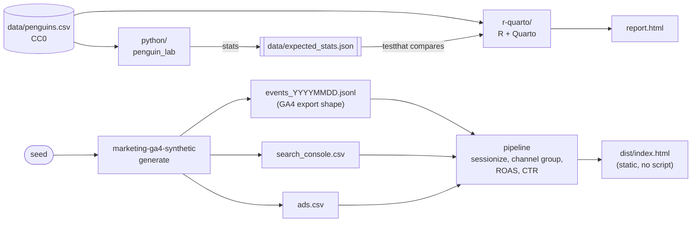
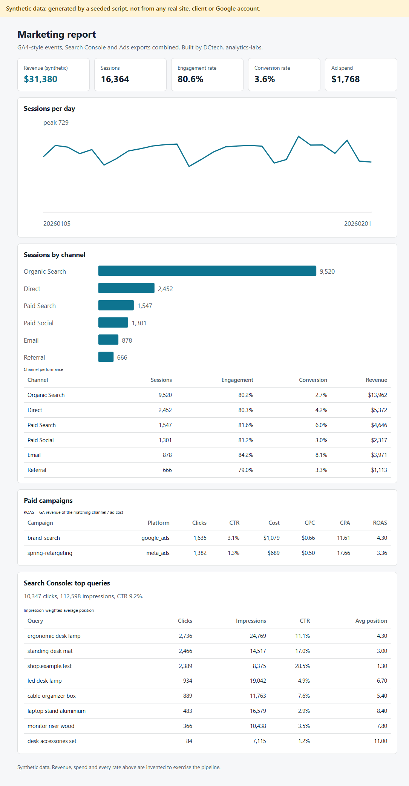

# analytics-labs

[](https://github.com/dc-tech-inc/analytics-labs/actions/workflows/ci.yml)
[](LICENSE)

A small analytics lab by [DCtech.](https://dctech.live): the same statistical analysis done twice, in **R with Quarto**
and in **Python with scikit-learn**, plus a **marketing reporting pipeline** that turns GA4-style events, Search
Console and Ads exports into a static dashboard.

> **Data honesty.** The statistics use a public dataset with a clear licence (Palmer penguins, CC0 1.0).
> The marketing pipeline runs only on **synthetic data** produced by a seeded script, shaped like the real exports.
> No real client, site or Google account was used, and the dashboard says so on screen.

The static dashboard for the synthetic pipeline is published with GitHub Pages at **https://dc-tech-inc.github.io/analytics-labs/** (see [ADR 0004](docs/adr/0004-static-dashboard-and-pages.md)).

## What is here

| Folder | What it proves | Run it |
|---|---|---|
| [`r-quarto/`](r-quarto) | R, ggplot2, Welch t-test, linear model, a Quarto report, `testthat` tests | `make r` (needs R and Quarto) |
| [`python/`](python) | The same analysis in pandas/SciPy, plus a logistic-regression classifier with scikit-learn, `pytest` | `make python` |
| [`marketing-ga4-synthetic/`](marketing-ga4-synthetic) | Sessionizing GA4 BigQuery-export rows, channel grouping, ad ROAS, Search Console metrics, a static dashboard | `make marketing` |
| [`data/`](data) | The dataset, its citation and licence, and the reference numbers the two implementations must agree on | |

## Architecture



The two implementations are not just parallel: Python writes `data/expected_stats.json`, and the R tests assert that R
reproduces the same Welch statistic and regression coefficients to 1e-8. A Python test fails if that file goes stale.

## Run it

```bash
make              # Python + marketing (no R needed), ends with dist/index.html
make r            # R tests and the Quarto report (needs R >= 4.1, the packages in r-quarto/DESCRIPTION, Quarto)
```

Without `make`:

```bash
cd python && pip install -e ".[dev]" && pytest && python -m penguin_lab.cli model
cd marketing-ga4-synthetic && pip install -e ".[dev]" && ga4-synth generate && ga4-synth report
```

## Results (computed on the public dataset)

333 complete observations. Adelie vs Gentoo flipper length (Welch t-test): t = -33.5, df = 251.4, p < 1e-90, Gentoo
27.1 mm longer on average. Body mass on flipper length: 50.2 g per mm, R² = 0.76 (pooled across species, which is
a confounder; see the limitations). A standardised logistic regression predicts species with 100 % accuracy on a
held-out 25 % split and 99.1 % in 5-fold cross-validation. These are illustrations of method on a teaching dataset,
not scientific findings.

## Marketing dashboard (synthetic data)



Revenue, spend and every rate in the picture are invented. Event rows carry the documented GA4 export fields
(`event_date`, `event_timestamp`, `event_name`, repeated `event_params`, `user_pseudo_id`, `device`, `geo`,
`traffic_source`, `ecommerce`); sessions are rebuilt by grouping on `user_pseudo_id` plus the `ga_session_id` event
parameter, as the export documentation describes. Paid clicks are generated close to the sessions GA records, and a
test checks they reconcile, because that reconciliation is the first thing to check with real exports.

## Decisions (short ADRs)

- [0001: Palmer penguins as the public dataset](docs/adr/0001-public-dataset.md)
- [0002: Python as the reference for R](docs/adr/0002-python-is-the-reference.md)
- [0003: Synthetic marketing data, standard library only](docs/adr/0003-synthetic-marketing-data.md)
- [0004: Static dashboard, no scripts, Pages only when public](docs/adr/0004-static-dashboard-and-pages.md)

## Limitations

- **R was not run on the author's machine** (R and Quarto are not installed there). The R code and report are
  exercised by CI on every push (`r-lib/actions` plus `quarto-dev/quarto-actions`) and cross-checked against the
  Python numbers; read the CI run, not a local screenshot, as the evidence.
- No R linter in CI yet (tracked in an issue); Python is linted with ruff.
- The penguins data is small and nearly separable by species, so the classifier's 100 % says little about modelling
  skill. The marketing generator makes every session a new user, so "users = sessions"; real data would not.
- Synthetic data has none of real traffic's bot noise, consent-mode gaps or attribution quirks. The channel rules
  are a simplified version of GA4's default channel group, not Google's exact logic.
- The report was built to demonstrate method and tooling. Nothing here is a benchmark of any business.

## Roadmap

See the open issues: an R linter in CI, a species-aware model for the regression, and a BigQuery-flavoured SQL version
of the sessionization.

## Sources

- Palmer penguins: Gorman, Williams and Fraser (2014), PLoS ONE 9(3):e90081, <https://doi.org/10.1371/journal.pone.0090081>;
  Horst, Hill and Gorman (2020), <https://doi.org/10.5281/zenodo.3960218>, <https://github.com/allisonhorst/palmerpenguins> (CC0).
- GA4 BigQuery export schema: <https://support.google.com/analytics/answer/7029846>
- Quarto in CI: <https://github.com/quarto-dev/quarto-actions> ; R in CI: <https://github.com/r-lib/actions>
- scikit-learn `LogisticRegression`, `train_test_split`, `cross_val_score`: <https://scikit-learn.org/stable/>
- SciPy `ttest_ind(equal_var=False)` (Welch): <https://docs.scipy.org/doc/scipy/reference/generated/scipy.stats.ttest_ind.html>

## Seção curta em português

Laboratório de análise da **DCtech.**: a mesma análise estatística em R (Quarto) e em Python (scikit-learn), mais um
pipeline de relatório de marketing no formato do export do GA4. Os dados estatísticos são públicos (CC0); os de
marketing são **sintéticos**, gerados por um script com semente. Nenhum dado real de cliente ou conta Google foi usado.
Rode `make` para Python e marketing; `make r` exige R e Quarto.

---

Copyright (c) 2026 DC TECH INC. Released under the [MIT License](LICENSE); the dataset is CC0 (see `data/README.md`).
